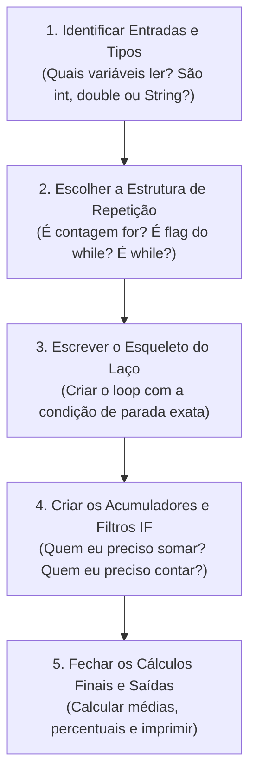

# 📚 GUIA DEFINITIVO DE LÓGICA E PADRÕES DE CÓDIGO PARA A PROVA
**Disciplina:** Algoritmos e Estruturas de Dados  
**Professor:** Ricardo Luiz de Freitas | Centro Universitário Dom Helder  
**Foco:** Conteúdos 8 (FOR), 9 (SÉRIES), 10 (DO WHILE) e 11 (WHILE)

---

## 🎯 1. TABELA DE DECISÃO RÁPIDA: QUAL LOOP USAR NA PROVA?

Ao ler o enunciado da prova, a primeira decisão é identificar a estrutura de repetição correta:

| Situação no Enunciado | Estrutura Recomendada | Exemplo no Enunciado |
| :--- | :---: | :--- |
| Quantidade **fixa ou pré-determinada** de repetições | `for` | *"Ler 50 alunos"*, *"Calcular para 100 números"*, *"Ler n no início e repetir n vezes"* |
| Quantidade **indefinida**, mas precisa executar **no mínimo 1 vez** | `do while` | *"Ler valores até que o usuário digite -1"*, *"Validar se sexo é M ou F"* |
| Quantidade **indefinida**, e o teste deve ser feito **antes de entrar** | `while` | *"Enquanto a condição for verdadeira repita..."*, *"Leitura de arquivo texto até o fim"* |
| Fórmula matemática com somatório/produtório de termos que evoluem | `for` (ou `while`) | *"$S = \\frac{1}{2} + \\frac{3}{4} + \\dots$"*, Cálculo de PI, Séries com $n$ termos |

---

## 🏗️ 2. OS 5 PADRÕES ESTRUTURAIS DE CÓDIGO DA APOSTILA

### 📌 Padrão 1: Repetição Definida com `for`
Usado quando a quantidade de repetições é conhecida antecipadamente.
```java
import java.util.Scanner;

public class PadraoFor {
    public static void main(String[] args) {
        // 1. DECLARAÇÃO DE VARIÁVEIS
        // Contadores são int / long; Médias e percentuais são double
        int contEspecial = 0;
        double somaGeral = 0, somaEspecial = 0;
        double maior = 0, menor = 0;
        String nomeMaior = "";
        
        Scanner teclado = new Scanner(System.in);
        
        // Se a quantidade for dinâmica, lê no início:
        System.out.print("Informe a quantidade de repetições: ");
        int total = teclado.nextInt();
        teclado.nextLine(); // Evita o bug do Java
        
        // 2. LAÇO FOR
        for (int aux = 1; aux <= total; aux++) {
            // Leitura
            System.out.print("Informe o nome: ");
            String nome = teclado.nextLine();
            System.out.print("Informe o valor: ");
            double valor = teclado.nextDouble();
            teclado.nextLine(); // Limpa buffer
            
            // Acumulador Geral
            somaGeral += valor;
            
            // Filtro / Condição Especial
            if (valor > 1000.00) {
                somaEspecial += valor;
                contEspecial++;
            }
            
            // Maior e Menor Valor (Técnica da 1ª iteração)
            if (aux == 1 || valor > maior) {
                maior = valor;
                nomeMaior = nome;
            }
            if (aux == 1 || valor < menor) {
                menor = valor;
            }
        }
        
        // 3. CÁLCULOS FINAIS E IMPRESSÃO
        double mediaGeral = somaGeral / total;
        System.out.println("Média Geral = " + mediaGeral);
        if (contEspecial > 0) {
            double mediaEspecial = somaEspecial / contEspecial;
            System.out.println("Média Especial = " + mediaEspecial);
        }
        System.out.println("Maior valor: " + nomeMaior + " com R$ " + maior);
        
        teclado.close();
    }
}
```

---

### 📌 Padrão 2: `do while` com FLAG FICTÍCIO (Não entra nos cálculos)
Usado quando o valor de parada é um sinalizador especial (ex: `-1`, `0`, `"FIM"`) e **não deve** ser somado nem contado.
```java
import java.util.Scanner;

public class PadraoDoWhileFlagFicticio {
    public static void main(String[] args) {
        double valor, soma = 0;
        int cont = 0;
        Scanner teclado = new Scanner(System.in);
        
        System.out.println("Para finalizar digite -1");
        do {
            System.out.print("Informe um valor: ");
            valor = teclado.nextDouble();
            
            // REGRA DE OURO: Proteja os cálculos com IF para isolar o flag!
            if (valor != -1) {
                soma += valor;
                cont++;
            }
        } while (valor != -1);
        
        if (cont > 0) {
            double media = soma / cont;
            System.out.println("Média = " + media);
        }
        teclado.close();
    }
}
```

---

### 📌 Padrão 3: `do while` com FLAG REAL (Entra nos cálculos)
Usado quando o último dado digitado é válido e **deve ser processado normalmente** antes de encerrar o programa (ex: *"A última cidade pesquisada é Zimbabue de Minas"*).
```java
import java.util.Scanner;

public class PadraoDoWhileFlagReal {
    public static void main(String[] args) {
        String nome;
        double valor, soma = 0;
        int cont = 0;
        Scanner teclado = new Scanner(System.in);
        
        System.out.println("O último elemento é FIM (entra nos cálculos)");
        do {
            System.out.print("Informe o nome: ");
            nome = teclado.nextLine();
            System.out.print("Informe o valor: ");
            valor = teclado.nextDouble();
            teclado.nextLine(); // Limpa buffer
            
            // Processa TODOS sem IF de exclusão
            soma += valor;
            cont++;
            
        } while (!nome.equalsIgnoreCase("FIM")); // Testa no final
        
        System.out.println("Total processado = " + soma);
        teclado.close();
    }
}
```

---

### 📌 Padrão 4: Validação Rigorosa de Entrada com `do while`
Repete a solicitação **enquanto** o dado digitado for inválido.
```java
// Validação de número (ex: código de 1 a 3)
int estadoCivil;
do {
    System.out.print("Estado Civil (1-Solteiro, 2-Casado, 3-Divorciado): ");
    estadoCivil = teclado.nextInt();
    if (estadoCivil != 1 && estadoCivil != 2 && estadoCivil != 3) {
        System.out.println("Código inválido! Informe novamente.");
    }
} while (estadoCivil != 1 && estadoCivil != 2 && estadoCivil != 3);

// Validação de String (ex: sexo M ou F)
String sexo;
do {
    System.out.print("Informe o sexo (M/F): ");
    sexo = teclado.nextLine();
    if (!sexo.equalsIgnoreCase("M") && !sexo.equalsIgnoreCase("F")) {
        System.out.println("Código inválido! Digite M ou F.");
    }
} while (!sexo.equalsIgnoreCase("M") && !sexo.equalsIgnoreCase("F"));
```

---

### 📌 Padrão 5: `while` com FLAG FICTÍCIO (Padrão Clássico de Dupla Leitura)
Lê antes do laço para testar a entrada. Se não for o flag, processa e lê novamente ao final do laço.
```java
import java.util.Scanner;

public class PadraoWhileFlagFicticio {
    public static void main(String[] args) {
        Scanner teclado = new Scanner(System.in);
        int cont = 0;
        double soma = 0;
        
        // 1ª Leitura FORA do laço
        System.out.print("Informe o nome (ou FIM para sair): ");
        String nome = teclado.nextLine();
        
        while (!nome.equalsIgnoreCase("FIM")) {
            System.out.print("Informe a nota: ");
            double nota = teclado.nextDouble();
            teclado.nextLine(); // Limpa buffer
            
            // Processamento direto (pois sabemos que nome != FIM)
            soma += nota;
            cont++;
            
            // 2ª Leitura NO FINAL do laço (para a próxima iteração)
            System.out.print("Informe o nome (ou FIM para sair): ");
            nome = teclado.nextLine();
        }
        
        if (cont > 0) {
            System.out.println("Média = " + (soma / cont));
        }
        teclado.close();
    }
}
```

---

### 📌 Padrão 6: Séries Matemáticas (Conteúdo 9)
Toda série deve ser decomposta em 4 blocos mentais:
1. **Inicialização do Acumulador:** `double serie = 0;` (ou `1` para multiplicações).
2. **Numerador (`num`):** Encontrar a fórmula em função da variável `aux`.
3. **Denominador (`den`):** Encontrar a fórmula em função da variável `aux`.
4. **Acabamento Externo:** Aplicar raízes ou potências globais após o término do laço.

```java
// Exemplo: S = 10 + raiz( sum( (aux^2) / sqrt(2*aux) ) )
double soma = 0;
for (int aux = 1; aux <= 20; aux++) {
    double num = Math.pow(aux, 2);
    double den = Math.sqrt(2.0 * aux);
    soma += num / den;
}
double serie = 10.0 + Math.sqrt(soma); // Acabamento externo
System.out.println("Valor da Série = " + serie);
```

**Regras Rápidas para Fórmulas de Séries:**
- **Progressão Aritmética (PA):** $termo = aux \times passo + ajuste$.
  - Exemplo: $3, 7, 11, 15, \dots$ (passo 4) $\rightarrow 4 \times aux - 1$.
- **Potências de Base Fixa:** `Math.pow(base, aux)` ou `Math.pow(base, aux - 1)`.
  - Exemplo: $1, 4, 16, 64, \dots$ $\rightarrow$ `Math.pow(4, aux - 1)`.
- **Sinais Alternados ($+ - + - \dots$):**
  ```java
  if (aux % 2 == 1) {
      soma += termo;
  } else {
      soma -= termo;
  }
  ```
- **Fatorial dentro do laço:**
  ```java
  double fat = 1.0;
  for (int aux = 1; aux <= n; aux++) {
      fat *= aux; // fat é o fatorial de aux!
      soma += fat / Math.pow(2, aux);
  }
  ```

---

## ⚠️ 3. AS 6 ARMADILHAS CLÁSSICAS EM JAVA QUE DESCONTAM NOTA

1. **O "Bug do Java" ao misturar leitura de números e textos:**
   - Ao ler número com `nextInt()` ou `nextDouble()` e em seguida ler texto com `nextLine()`, a quebra de linha `\n` que sobrou no buffer é lida pelo `nextLine()`, pulando a digitação do usuário!
   - **SOLUÇÃO:** Sempre adicione um `teclado.nextLine();` logo após ler o número!
2. **Divisão Inteira Oculta:**
   - Em Java, `5 / 2` resulta em `2`, porque ambos são inteiros!
   - **SOLUÇÃO:** Use pelo menos um operando `double`: `soma / (double)cont` ou `soma / 5.0` ou `(float)soma / cont`.
3. **Comparação de Strings:**
   - **NUNCA** compare Strings com `==` (ex: `nome == "FIM"` compara referências de memória, quase sempre dá falso!).
   - **SEMPRE** use `nome.equalsIgnoreCase("FIM")` ou `!nome.equalsIgnoreCase("FIM")`.
4. **Divisão por Zero:**
   - Se o usuário digitar o flag logo de primeira, `cont` será `0`. Fazer `soma / cont` gera `NaN` ou `Infinity`.
   - **SOLUÇÃO:** Sempre faça `if (cont > 0) { ... } else { System.out.println("Nenhum dado informado"); }`.
5. **Inicialização de Maior e Menor:**
   - Iniciar `menor = 0` para valores positivos faz com que o menor valor seja eternamente `0`!
   - **SOLUÇÃO:** Use a técnica do primeiro elemento:
     `if (aux == 1 || valor < menor) { menor = valor; }`
6. **Formatação de Decimais:**
   - Em provas, utilize `System.out.printf("%.2f\n", media);` quando for solicitado número de casas decimais.

---

## 🧩 4. A METODOLOGIA "DIVIDIR E CONQUISTAR" (COMO PENSAR NA HORA DA PROVA)

Quando você receber uma questão grande na prova de amanhã, não tente escrever o código inteiro de uma vez. Divida em **5 subproblemas simples**:



---
