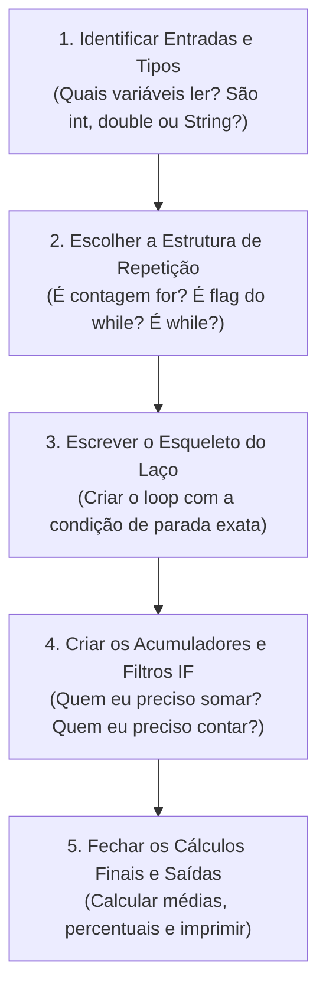

# 🏆 SIMULADO COMPLETO DE ALGORITMOS - 40 QUESTÕES RESOLVIDAS
**Material de Preparação para a Prova de Algoritmos e Estruturas de Dados**  
**Professor:** Ricardo Luiz de Freitas | Centro Universitário Dom Helder  
**Metodologia:** Dividir e Conquistar (Subproblemas, Raciocínio Lógico e Implementação em Java)

---

## 📌 CHECKLIST MENTAL PARA A PROVA DE AMANHÃ
1. [ ] **Leitura Atenta:** Sublinhe as entradas, os filtros e o que o enunciado pede para imprimir.
2. [ ] **Qual Laço?**
   - Quantidade fixa $\\rightarrow$ use `for`.
   - Repete até digitar flag e testa no fim $\\rightarrow$ use `do while`.
   - Repete com leitura prévia $\\rightarrow$ use `while`.
3. [ ] **Flag Fictício vs. Real:**
   - Flag Fictício $\\rightarrow$ precisa de `if (variavel != flag)` antes de somar/contar!
   - Flag Real $\\rightarrow$ soma/conta direto, o flag também entra no cálculo.
4. [ ] **Bug do Scanner:** Se leu número com `nextInt()` ou `nextDouble()` e vai ler `nextLine()`, coloque um `teclado.nextLine();` para limpar o buffer!
5. [ ] **Comparação de String:** Use `!nome.equalsIgnoreCase("FIM")`. Nunca use `==`!
6. [ ] **Média:** Sempre proteja com `if (cont > 0)` para não dividir por zero.

---

# 📚 GUIA DEFINITIVO DE LÓGICA E PADRÕES DE CÓDIGO PARA A PROVA
**Disciplina:** Algoritmos e Estruturas de Dados  
**Professor:** Ricardo Luiz de Freitas | Centro Universitário Dom Helder  
**Foco:** Conteúdos 8 (FOR), 9 (SÉRIES), 10 (DO WHILE) e 11 (WHILE)

---

## 🎯 1. TABELA DE DECISÃO RÁPIDA: QUAL LOOP USAR NA PROVA?

Ao ler o enunciado da prova, a primeira decisão é identificar a estrutura de repetição correta:

| Situação no Enunciado | Estrutura Recomendada | Exemplo no Enunciado |
| :--- | :---: | :--- |
| Quantidade **fixa ou pré-determinada** de repetições | `for` | *"Ler 50 alunos"*, *"Calcular para 100 números"*, *"Ler n no início e repetir n vezes"* |
| Quantidade **indefinida**, mas precisa executar **no mínimo 1 vez** | `do while` | *"Ler valores até que o usuário digite -1"*, *"Validar se sexo é M ou F"* |
| Quantidade **indefinida**, e o teste deve ser feito **antes de entrar** | `while` | *"Enquanto a condição for verdadeira repita..."*, *"Leitura de arquivo texto até o fim"* |
| Fórmula matemática com somatório/produtório de termos que evoluem | `for` (ou `while`) | *"$S = \\frac{1}{2} + \\frac{3}{4} + \\dots$"*, Cálculo de PI, Séries com $n$ termos |

---

## 🏗️ 2. OS 5 PADRÕES ESTRUTURAIS DE CÓDIGO DA APOSTILA

### 📌 Padrão 1: Repetição Definida com `for`
Usado quando a quantidade de repetições é conhecida antecipadamente.
```java
import java.util.Scanner;

public class PadraoFor {
    public static void main(String[] args) {
        // 1. DECLARAÇÃO DE VARIÁVEIS
        // Contadores são int / long; Médias e percentuais são double
        int contEspecial = 0;
        double somaGeral = 0, somaEspecial = 0;
        double maior = 0, menor = 0;
        String nomeMaior = "";
        
        Scanner teclado = new Scanner(System.in);
        
        // Se a quantidade for dinâmica, lê no início:
        System.out.print("Informe a quantidade de repetições: ");
        int total = teclado.nextInt();
        teclado.nextLine(); // Evita o bug do Java
        
        // 2. LAÇO FOR
        for (int aux = 1; aux <= total; aux++) {
            // Leitura
            System.out.print("Informe o nome: ");
            String nome = teclado.nextLine();
            System.out.print("Informe o valor: ");
            double valor = teclado.nextDouble();
            teclado.nextLine(); // Limpa buffer
            
            // Acumulador Geral
            somaGeral += valor;
            
            // Filtro / Condição Especial
            if (valor > 1000.00) {
                somaEspecial += valor;
                contEspecial++;
            }
            
            // Maior e Menor Valor (Técnica da 1ª iteração)
            if (aux == 1 || valor > maior) {
                maior = valor;
                nomeMaior = nome;
            }
            if (aux == 1 || valor < menor) {
                menor = valor;
            }
        }
        
        // 3. CÁLCULOS FINAIS E IMPRESSÃO
        double mediaGeral = somaGeral / total;
        System.out.println("Média Geral = " + mediaGeral);
        if (contEspecial > 0) {
            double mediaEspecial = somaEspecial / contEspecial;
            System.out.println("Média Especial = " + mediaEspecial);
        }
        System.out.println("Maior valor: " + nomeMaior + " com R$ " + maior);
        
        teclado.close();
    }
}
```

---

### 📌 Padrão 2: `do while` com FLAG FICTÍCIO (Não entra nos cálculos)
Usado quando o valor de parada é um sinalizador especial (ex: `-1`, `0`, `"FIM"`) e **não deve** ser somado nem contado.
```java
import java.util.Scanner;

public class PadraoDoWhileFlagFicticio {
    public static void main(String[] args) {
        double valor, soma = 0;
        int cont = 0;
        Scanner teclado = new Scanner(System.in);
        
        System.out.println("Para finalizar digite -1");
        do {
            System.out.print("Informe um valor: ");
            valor = teclado.nextDouble();
            
            // REGRA DE OURO: Proteja os cálculos com IF para isolar o flag!
            if (valor != -1) {
                soma += valor;
                cont++;
            }
        } while (valor != -1);
        
        if (cont > 0) {
            double media = soma / cont;
            System.out.println("Média = " + media);
        }
        teclado.close();
    }
}
```

---

### 📌 Padrão 3: `do while` com FLAG REAL (Entra nos cálculos)
Usado quando o último dado digitado é válido e **deve ser processado normalmente** antes de encerrar o programa (ex: *"A última cidade pesquisada é Zimbabue de Minas"*).
```java
import java.util.Scanner;

public class PadraoDoWhileFlagReal {
    public static void main(String[] args) {
        String nome;
        double valor, soma = 0;
        int cont = 0;
        Scanner teclado = new Scanner(System.in);
        
        System.out.println("O último elemento é FIM (entra nos cálculos)");
        do {
            System.out.print("Informe o nome: ");
            nome = teclado.nextLine();
            System.out.print("Informe o valor: ");
            valor = teclado.nextDouble();
            teclado.nextLine(); // Limpa buffer
            
            // Processa TODOS sem IF de exclusão
            soma += valor;
            cont++;
            
        } while (!nome.equalsIgnoreCase("FIM")); // Testa no final
        
        System.out.println("Total processado = " + soma);
        teclado.close();
    }
}
```

---

### 📌 Padrão 4: Validação Rigorosa de Entrada com `do while`
Repete a solicitação **enquanto** o dado digitado for inválido.
```java
// Validação de número (ex: código de 1 a 3)
int estadoCivil;
do {
    System.out.print("Estado Civil (1-Solteiro, 2-Casado, 3-Divorciado): ");
    estadoCivil = teclado.nextInt();
    if (estadoCivil != 1 && estadoCivil != 2 && estadoCivil != 3) {
        System.out.println("Código inválido! Informe novamente.");
    }
} while (estadoCivil != 1 && estadoCivil != 2 && estadoCivil != 3);

// Validação de String (ex: sexo M ou F)
String sexo;
do {
    System.out.print("Informe o sexo (M/F): ");
    sexo = teclado.nextLine();
    if (!sexo.equalsIgnoreCase("M") && !sexo.equalsIgnoreCase("F")) {
        System.out.println("Código inválido! Digite M ou F.");
    }
} while (!sexo.equalsIgnoreCase("M") && !sexo.equalsIgnoreCase("F"));
```

---

### 📌 Padrão 5: `while` com FLAG FICTÍCIO (Padrão Clássico de Dupla Leitura)
Lê antes do laço para testar a entrada. Se não for o flag, processa e lê novamente ao final do laço.
```java
import java.util.Scanner;

public class PadraoWhileFlagFicticio {
    public static void main(String[] args) {
        Scanner teclado = new Scanner(System.in);
        int cont = 0;
        double soma = 0;
        
        // 1ª Leitura FORA do laço
        System.out.print("Informe o nome (ou FIM para sair): ");
        String nome = teclado.nextLine();
        
        while (!nome.equalsIgnoreCase("FIM")) {
            System.out.print("Informe a nota: ");
            double nota = teclado.nextDouble();
            teclado.nextLine(); // Limpa buffer
            
            // Processamento direto (pois sabemos que nome != FIM)
            soma += nota;
            cont++;
            
            // 2ª Leitura NO FINAL do laço (para a próxima iteração)
            System.out.print("Informe o nome (ou FIM para sair): ");
            nome = teclado.nextLine();
        }
        
        if (cont > 0) {
            System.out.println("Média = " + (soma / cont));
        }
        teclado.close();
    }
}
```

---

### 📌 Padrão 6: Séries Matemáticas (Conteúdo 9)
Toda série deve ser decomposta em 4 blocos mentais:
1. **Inicialização do Acumulador:** `double serie = 0;` (ou `1` para multiplicações).
2. **Numerador (`num`):** Encontrar a fórmula em função da variável `aux`.
3. **Denominador (`den`):** Encontrar a fórmula em função da variável `aux`.
4. **Acabamento Externo:** Aplicar raízes ou potências globais após o término do laço.

```java
// Exemplo: S = 10 + raiz( sum( (aux^2) / sqrt(2*aux) ) )
double soma = 0;
for (int aux = 1; aux <= 20; aux++) {
    double num = Math.pow(aux, 2);
    double den = Math.sqrt(2.0 * aux);
    soma += num / den;
}
double serie = 10.0 + Math.sqrt(soma); // Acabamento externo
System.out.println("Valor da Série = " + serie);
```

**Regras Rápidas para Fórmulas de Séries:**
- **Progressão Aritmética (PA):** $termo = aux \times passo + ajuste$.
  - Exemplo: $3, 7, 11, 15, \dots$ (passo 4) $\rightarrow 4 \times aux - 1$.
- **Potências de Base Fixa:** `Math.pow(base, aux)` ou `Math.pow(base, aux - 1)`.
  - Exemplo: $1, 4, 16, 64, \dots$ $\rightarrow$ `Math.pow(4, aux - 1)`.
- **Sinais Alternados ($+ - + - \dots$):**
  ```java
  if (aux % 2 == 1) {
      soma += termo;
  } else {
      soma -= termo;
  }
  ```
- **Fatorial dentro do laço:**
  ```java
  double fat = 1.0;
  for (int aux = 1; aux <= n; aux++) {
      fat *= aux; // fat é o fatorial de aux!
      soma += fat / Math.pow(2, aux);
  }
  ```

---

## ⚠️ 3. AS 6 ARMADILHAS CLÁSSICAS EM JAVA QUE DESCONTAM NOTA

1. **O "Bug do Java" ao misturar leitura de números e textos:**
   - Ao ler número com `nextInt()` ou `nextDouble()` e em seguida ler texto com `nextLine()`, a quebra de linha `\n` que sobrou no buffer é lida pelo `nextLine()`, pulando a digitação do usuário!
   - **SOLUÇÃO:** Sempre adicione um `teclado.nextLine();` logo após ler o número!
2. **Divisão Inteira Oculta:**
   - Em Java, `5 / 2` resulta em `2`, porque ambos são inteiros!
   - **SOLUÇÃO:** Use pelo menos um operando `double`: `soma / (double)cont` ou `soma / 5.0` ou `(float)soma / cont`.
3. **Comparação de Strings:**
   - **NUNCA** compare Strings com `==` (ex: `nome == "FIM"` compara referências de memória, quase sempre dá falso!).
   - **SEMPRE** use `nome.equalsIgnoreCase("FIM")` ou `!nome.equalsIgnoreCase("FIM")`.
4. **Divisão por Zero:**
   - Se o usuário digitar o flag logo de primeira, `cont` será `0`. Fazer `soma / cont` gera `NaN` ou `Infinity`.
   - **SOLUÇÃO:** Sempre faça `if (cont > 0) { ... } else { System.out.println("Nenhum dado informado"); }`.
5. **Inicialização de Maior e Menor:**
   - Iniciar `menor = 0` para valores positivos faz com que o menor valor seja eternamente `0`!
   - **SOLUÇÃO:** Use a técnica do primeiro elemento:
     `if (aux == 1 || valor < menor) { menor = valor; }`
6. **Formatação de Decimais:**
   - Em provas, utilize `System.out.printf("%.2f\n", media);` quando for solicitado número de casas decimais.

---

## 🧩 4. A METODOLOGIA "DIVIDIR E CONQUISTAR" (COMO PENSAR NA HORA DA PROVA)

Quando você receber uma questão grande na prova de amanhã, não tente escrever o código inteiro de uma vez. Divida em **5 subproblemas simples**:



---
\n\n---\n\n# 🎯 MÓDULO 1: DOMÍNIO DO COMANDO `FOR`, CONTADORES E ACUMULADORES
**Foco:** Conteúdo 8 (Repetições Definidas, Contagens, Somatórios, Média, Maior/Menor)

---

### 📝 Questão 01: Contagem e Somatório de Positivos e Negativos
**Enunciado:** Faça um programa que solicite ao usuário 10 números inteiros. Calcule e imprima:
- A quantidade de números positivos (maiores ou iguais a zero);
- A quantidade de números negativos;
- A soma de todos os números negativos.

#### 🧩 Metodologia Dividir e Conquistar:
1. **Entradas:** 10 números inteiros informados pelo usuário.
2. **Estrutura:** Laço `for (int aux = 1; aux <= 10; aux++)`.
3. **Filtro/Condição:** Se `numero >= 0`, incrementa `contPositivos`. Senão, incrementa `contNegativos` e acumula `somaNegativos += numero`.
4. **Saídas:** Imprimir os três resultados no final.

```java
import java.util.Scanner;

public class Questao01 {
    public static void main(String[] args) {
        int contPositivos = 0, contNegativos = 0, somaNegativos = 0;
        Scanner teclado = new Scanner(System.in);

        for (int aux = 1; aux <= 10; aux++) {
            System.out.print("Informe o " + aux + "º número: ");
            int numero = teclado.nextInt();

            if (numero >= 0) {
                contPositivos++;
            } else {
                contNegativos++;
                somaNegativos += numero;
            }
        }

        System.out.println("Quantidade de positivos = " + contPositivos);
        System.out.println("Quantidade de negativos = " + contNegativos);
        System.out.println("Soma dos negativos = " + somaNegativos);
        teclado.close();
    }
}
```

---

### 📝 Questão 02: Múltiplos e Divisibilidade no Intervalo
**Enunciado:** Faça um programa que leia um número $N$ no início e, para todos os números inteiros de 1 até $N$, informe se cada número é divisível por 5. Ao final, imprima a quantidade de números divisíveis por 5 e a soma deles.

#### 🧩 Metodologia Dividir e Conquistar:
1. **Entrada:** Um número inteiro $N$.
2. **Estrutura:** `for (int aux = 1; aux <= N; aux++)`.
3. **Teste de Divisibilidade:** Operador resto `%`. Se `aux % 5 == 0`, o número é múltiplo.
4. **Acumulação:** Incrementar contador e somar o valor de `aux`.

```java
import java.util.Scanner;

public class Questao02 {
    public static void main(String[] args) {
        int cont = 0, soma = 0;
        Scanner teclado = new Scanner(System.in);

        System.out.print("Informe o limite N: ");
        int n = teclado.nextInt();

        for (int aux = 1; aux <= n; aux++) {
            if (aux % 5 == 0) {
                System.out.println(aux + " é divisível por 5");
                cont++;
                soma += aux;
            }
        }

        System.out.println("Total de divisíveis por 5 = " + cont);
        System.out.println("Soma dos divisíveis por 5 = " + soma);
        teclado.close();
    }
}
```

---

### 📝 Questão 03: Média de Notas com Filtro de Intervalo (1 a 100)
**Enunciado:** Faça um programa que leia as notas de 8 alunos. Calcule e imprima a média apenas dos alunos que tiraram notas válidas entre 0 e 100. Se nenhuma nota for válida, avise o usuário.

#### 🧩 Metodologia Dividir e Conquistar:
1. **Armadilha:** Não dividir por 8! Dividir apenas pela quantidade de notas válidas (`contValidas`).
2. **Filtro:** `if (nota >= 0 && nota <= 100)`.
3. **Cuidado:** Testar `if (contValidas > 0)` antes de calcular a média.

```java
import java.util.Scanner;

public class Questao03 {
    public static void main(String[] args) {
        double soma = 0;
        int contValidas = 0;
        Scanner teclado = new Scanner(System.in);

        for (int aux = 1; aux <= 8; aux++) {
            System.out.print("Informe a nota do aluno " + aux + ": ");
            double nota = teclado.nextDouble();

            if (nota >= 0 && nota <= 100) {
                soma += nota;
                contValidas++;
            } else {
                System.out.println("Nota fora da faixa (ignorada)");
            }
        }

        if (contValidas > 0) {
            double media = soma / contValidas;
            System.out.printf("Média das notas válidas = %.2f\n", media);
        } else {
            System.out.println("Nenhuma nota válida foi informada!");
        }

        teclado.close();
    }
}
```

---

### 📝 Questão 04: Aprovado/Reprovado por Nota e Frequência
**Enunciado:** Uma disciplina tem 10 alunos. Para ser aprovado, o aluno precisa de Nota $\ge 60$ **e** Total de Faltas $\le 15$. Faça um programa que leia a nota e as faltas de cada aluno, informe a situação individual e, no final, a quantidade total de aprovados e reprovados.

#### 🧩 Metodologia Dividir e Conquistar:
1. **Condição Composta:** `if (nota >= 60 && faltas <= 15)`.
2. **Contadores Independentes:** `aprovados++` e `reprovados++`.

```java
import java.util.Scanner;

public class Questao04 {
    public static void main(String[] args) {
        int aprovados = 0, reprovados = 0;
        Scanner teclado = new Scanner(System.in);

        for (int aux = 1; aux <= 10; aux++) {
            System.out.print("Aluno " + aux + " - Nota: ");
            double nota = teclado.nextDouble();
            System.out.print("Aluno " + aux + " - Faltas: ");
            int faltas = teclado.nextInt();

            if (nota >= 60 && faltas <= 15) {
                System.out.println("Situação: APROVADO");
                aprovados++;
            } else {
                System.out.println("Situação: REPROVADO");
                reprovados++;
            }
        }

        System.out.println("\nTotal de Aprovados: " + aprovados);
        System.out.println("Total de Reprovados: " + reprovados);
        teclado.close();
    }
}
```

---

### 📝 Questão 05: Pesquisa de Maior e Menor Preço com Nome do Posto
**Enunciado:** Faça um programa para pesquisar o preço do combustível em 5 postos. O programa deverá ler o nome do posto e o preço do combustível, e ao final informar:
- O nome e o preço do posto mais caro;
- O nome e o preço do posto mais barato.

#### 🧩 Metodologia Dividir e Conquistar:
1. **Técnica do 1º Elemento:** `if (aux == 1 || preco > maiorPreco)`.
2. **Buffer do Java:** Lembrar de `teclado.nextLine()` após `nextDouble()`.

```java
import java.util.Scanner;

public class Questao05 {
    public static void main(String[] args) {
        double maiorPreco = 0, menorPreco = 0;
        String postoMaisCaro = "", postoMaisBarato = "";
        Scanner teclado = new Scanner(System.in);

        for (int aux = 1; aux <= 5; aux++) {
            System.out.print("Nome do Posto " + aux + ": ");
            String nome = teclado.nextLine();
            System.out.print("Preço da gasolina: ");
            double preco = teclado.nextDouble();
            teclado.nextLine(); // Evita bug do Java

            if (aux == 1 || preco > maiorPreco) {
                maiorPreco = preco;
                postoMaisCaro = nome;
            }
            if (aux == 1 || preco < menorPreco) {
                menorPreco = preco;
                postoMaisBarato = nome;
            }
        }

        System.out.printf("\nPosto mais caro: %s (R$ %.2f)\n", postoMaisCaro, maiorPreco);
        System.out.printf("Posto mais barato: %s (R$ %.2f)\n", postoMaisBarato, menorPreco);
        teclado.close();
    }
}
```

---

### 📝 Questão 06: Estatística de Faixas Etárias e Percentuais
**Enunciado:** Leia a idade de 15 pessoas e calcule:
- Quantidade de menores de idade ($< 18$);
- Quantidade de adultos ($18$ a $59$);
- Quantidade de idosos ($\ge 60$);
- O percentual de idosos em relação ao total.

#### 🧩 Metodologia Dividir e Conquistar:
1. **Contadores de Faixa:** `menores`, `adultos`, `idosos`.
2. **Cálculo Percentual:** `(idosos * 100.0) / 15.0`.

```java
import java.util.Scanner;

public class Questao06 {
    public static void main(String[] args) {
        int menores = 0, adultos = 0, idosos = 0;
        Scanner teclado = new Scanner(System.in);

        for (int aux = 1; aux <= 15; aux++) {
            System.out.print("Idade da pessoa " + aux + ": ");
            int idade = teclado.nextInt();

            if (idade < 18) {
                menores++;
            } else if (idade <= 59) {
                adultos++;
            } else {
                idosos++;
            }
        }

        double percIdosos = (idosos * 100.0) / 15.0;

        System.out.println("Menores de 18: " + menores);
        System.out.println("Adultos (18-59): " + adultos);
        System.out.println("Idosos (>=60): " + idosos);
        System.out.printf("Percentual de idosos = %.2f%%\n", percIdosos);
        teclado.close();
    }
}
```

---

### 📝 Questão 07: Apuração de Votação (Candidato 1, 2 e Nulos)
**Enunciado:** Faça um programa para apurar 20 votos de uma eleição entre Candidato 1 e Candidato 2. Qualquer voto diferente de 1 e 2 é considerado nulo. Ao final, imprima a quantidade de votos de cada um, a quantidade de nulos e o nome do vencedor (ou mensagem de empate).

```java
import java.util.Scanner;

public class Questao07 {
    public static void main(String[] args) {
        int v1 = 0, v2 = 0, nulos = 0;
        Scanner teclado = new Scanner(System.in);

        for (int aux = 1; aux <= 20; aux++) {
            System.out.print("Voto do eleitor " + aux + " (1-Candidato 1, 2-Candidato 2): ");
            int voto = teclado.nextInt();

            if (voto == 1) {
                v1++;
            } else if (voto == 2) {
                v2++;
            } else {
                nulos++;
            }
        }

        System.out.println("\nResultado:");
        System.out.println("Candidato 1: " + v1 + " votos");
        System.out.println("Candidato 2: " + v2 + " votos");
        System.out.println("Nulos: " + nulos + " votos");

        if (v1 > v2) {
            System.out.println("Vencedor: Candidato 1");
        } else if (v2 > v1) {
            System.out.println("Vencedor: Candidato 2");
        } else {
            System.out.println("Resultado: EMPATE");
        }
        teclado.close();
    }
}
```

---

### 📝 Questão 08: Tabuada Personalizada com Controle de Limite
**Enunciado:** Solicite ao usuário qual tabuada ele quer ver (número $N$) e até qual multiplicador $M$ ele quer calcular. Gere a tabuada de 1 até $M$.

```java
import java.util.Scanner;

public class Questao08 {
    public static void main(String[] args) {
        Scanner teclado = new Scanner(System.in);

        System.out.print("Deseja ver a tabuada de qual número? ");
        int n = teclado.nextInt();
        System.out.print("Até qual multiplicador? ");
        int m = teclado.nextInt();

        for (int aux = 1; aux <= m; aux++) {
            System.out.println(aux + " x " + n + " = " + (aux * n));
        }

        teclado.close();
    }
}
```

---

### 📝 Questão 09: Padrão Visual em Triângulo com `for` Aninhado
**Enunciado:** Leia um número inteiro $N$ ($1$ a $10$) e gere o padrão abaixo:
Se $N = 4$:
```
#
# #
# # #
# # # #
```

#### 🧩 Metodologia Dividir e Conquistar:
1. **Loop Externo (`i`):** Controla o número da linha (de 1 até $N$).
2. **Loop Interno (`j`):** Controla a quantidade de símbolos daquela linha (de 1 até $i$).
3. **Quebra de linha:** `System.out.println();` fora do loop interno, dentro do externo.

```java
import java.util.Scanner;

public class Questao09 {
    public static void main(String[] args) {
        Scanner teclado = new Scanner(System.in);
        System.out.print("Informe N (1 a 10): ");
        int n = teclado.nextInt();

        for (int i = 1; i <= n; i++) {
            for (int j = 1; j <= i; j++) {
                System.out.print("# ");
            }
            System.out.println();
        }

        teclado.close();
    }
}
```

---

### 📝 Questão 10: Simulação Financeira de Rendimento Mensal
**Enunciado:** Uma pessoa aplicou um capital inicial $C$ a uma taxa de juros fixa de $0,8\%$ ao mês durante 12 meses. Faça um programa que imprima o saldo mês a mês e o ganho total de juros ao fim de 1 ano.

```java
import java.util.Scanner;

public class Questao10 {
    public static void main(String[] args) {
        Scanner teclado = new Scanner(System.in);
        System.out.print("Informe o capital inicial aplicado (R$): ");
        double saldo = teclado.nextDouble();
        double capitalInicial = saldo;

        for (int mes = 1; mes <= 12; mes++) {
            saldo += saldo * 0.008; // Rende 0.8%
            System.out.printf("Mês %2d: R$ %.2f\n", mes, saldo);
        }

        double lucro = saldo - capitalInicial;
        System.out.printf("\nRendimento total após 12 meses = R$ %.2f\n", lucro);
        teclado.close();
    }
}
```
\n\n---\n\n# 🎯 MÓDULO 2: SÉRIES MATEMÁTICAS E DECOMPOSIÇÃO DE FÓRMULAS
**Foco:** Conteúdo 9 (Séries Finitas e Infinitas, Numerador/Denominador, Raízes, Potências, Fatoriais, Sinais Alternados)

---

### 📝 Questão 11: Progressão Aritmética no Numerador e Denominador
**Enunciado:** Calcule e imprima o valor da série abaixo para 50 termos:
$$S = \\frac{1}{2} + \\frac{3}{5} + \\frac{5}{8} + \\frac{7}{11} + \\dots$$

#### 🧩 Metodologia Dividir e Conquistar:
1. **Numerador:** $1, 3, 5, 7, \dots \rightarrow$ Razão $2$. Fórmula: $2 \times aux - 1$.
   - Teste: $aux = 1 \rightarrow 2(1)-1 = 1$; $aux = 2 \rightarrow 2(2)-1 = 3$. Perfeito.
2. **Denominador:** $2, 5, 8, 11, \dots \rightarrow$ Razão $3$. Fórmula: $3 \times aux - 1$.
   - Teste: $aux = 1 \rightarrow 3(1)-1 = 2$; $aux = 2 \rightarrow 3(2)-1 = 5$. Perfeito.
3. **Acumulação:** `serie += num / den;`.

```java
public class Questao11 {
    public static void main(String[] args) {
        double serie = 0;
        for (int aux = 1; aux <= 50; aux++) {
            double num = 2.0 * aux - 1.0;
            double den = 3.0 * aux - 1.0;
            serie += num / den;
        }
        System.out.printf("Valor da Série = %.6f\n", serie);
    }
}
```

---

### 📝 Questão 12: Raiz Quadrada no Denominador
**Enunciado:** Calcule e imprima o valor da série para 30 termos:
$$S = \\frac{1}{\\sqrt{3}} + \\frac{2}{\\sqrt{5}} + \\frac{3}{\\sqrt{7}} + \\frac{4}{\\sqrt{9}} + \\dots$$

#### 🧩 Metodologia Dividir e Conquistar:
1. **Numerador:** $aux$ direto ($1, 2, 3, 4, \dots$).
2. **Denominador:** $\\sqrt{2 \times aux + 1}$.
   - Para $aux=1$: $\\sqrt{3}$; $aux=2$: $\\sqrt{5}$; $aux=3$: $\\sqrt{7}$.
3. **Código em Java:** `Math.sqrt(2.0 * aux + 1.0)`.

```java
public class Questao12 {
    public static void main(String[] args) {
        double serie = 0;
        for (int aux = 1; aux <= 30; aux++) {
            double num = aux;
            double den = Math.sqrt(2.0 * aux + 1.0);
            serie += num / den;
        }
        System.out.printf("Valor da Série = %.6f\n", serie);
    }
}
```

---

### 📝 Questão 13: Série com Sinais Alternados (+ e -)
**Enunciado:** Calcule e imprima o valor da série com 40 termos:
$$S = \\frac{1}{1} - \\frac{2}{4} + \\frac{3}{9} - \\frac{4}{16} + \\frac{5}{25} - \\dots$$

#### 🧩 Metodologia Dividir e Conquistar:
1. **Módulo do termo:** $\\frac{aux}{aux^2} = \\frac{1}{aux}$.
2. **Alternância de Sinais:**
   - Termos ímpares ($aux = 1, 3, 5$): Positivos ($+$).
   - Termos pares ($aux = 2, 4, 6$): Negativos ($-$).
3. **Técnica:** `if (aux % 2 == 1) serie += termo; else serie -= termo;`

```java
public class Questao13 {
    public static void main(String[] args) {
        double serie = 0;
        for (int aux = 1; aux <= 40; aux++) {
            double termo = (double) aux / Math.pow(aux, 2);
            if (aux % 2 == 1) {
                serie += termo;
            } else {
                serie -= termo;
            }
        }
        System.out.printf("Valor da Série = %.6f\n", serie);
    }
}
```

---

### 📝 Questão 14: Série com Potência de $X$ e $N$ Termos
**Enunciado:** Faça um programa que solicite ao usuário um valor real $X$ e uma quantidade inteira de termos $N$, calculando:
$$S = \\frac{X^1}{2} + \\frac{X^2}{4} + \\frac{X^3}{6} + \\dots + \\frac{X^N}{2N}$$

```java
import java.util.Scanner;

public class Questao14 {
    public static void main(String[] args) {
        Scanner teclado = new Scanner(System.in);
        System.out.print("Informe o valor de X: ");
        double x = teclado.nextDouble();
        System.out.print("Informe a quantidade de termos N: ");
        int n = teclado.nextInt();

        double serie = 0;
        for (int aux = 1; aux <= n; aux++) {
            double num = Math.pow(x, aux);
            double den = 2.0 * aux;
            serie += num / den;
        }

        System.out.printf("Valor da Série = %.6f\n", serie);
        teclado.close();
    }
}
```

---

### 📝 Questão 15: Fatorial Progressivo no Numerador
**Enunciado:** Calcule e imprima o valor da série para 10 termos:
$$S = \\frac{1!}{2^1} + \\frac{2!}{2^2} + \\frac{3!}{2^3} + \\dots + \\frac{10!}{2^{10}}$$

#### 🧩 Metodologia Dividir e Conquistar:
1. **Como calcular fatorial sem recalcular do zero:**
   - Inicie `double fat = 1.0;` fora do laço.
   - Em cada iteração: `fat *= aux;`. Pronto!
2. **Denominador:** `Math.pow(2.0, aux)`.

```java
public class Questao15 {
    public static void main(String[] args) {
        double serie = 0;
        double fat = 1.0;

        for (int aux = 1; aux <= 10; aux++) {
            fat *= aux; // 1!, 2!, 3!, ...
            double den = Math.pow(2.0, aux);
            serie += fat / den;
        }

        System.out.printf("Valor da Série = %.6f\n", serie);
    }
}
```

---

### 📝 Questão 16: Transformação Global com Raiz Cúbica Externa
**Enunciado:** Calcule o valor da série para 25 termos:
$$S = 100 + \\sqrt[3]{\\sum_{aux=1}^{25} \\frac{aux \times 10}{(aux+1)^2}}$$

#### 🧩 Metodologia Dividir e Conquistar:
1. **Passo Interno:** Acumule apenas a soma das frações dentro do laço.
2. **Passo Externo:** Após o laço terminar, aplique `Math.cbrt(soma)` e some $100$.

```java
public class Questao16 {
    public static void main(String[] args) {
        double soma = 0;
        for (int aux = 1; aux <= 25; aux++) {
            double num = aux * 10.0;
            double den = Math.pow(aux + 1.0, 2);
            soma += num / den;
        }

        double serie = 100.0 + Math.cbrt(soma);
        System.out.printf("Valor da Série = %.6f\n", serie);
    }
}
```

---

### 📝 Questão 17: Numerador Composto de Dois Termos
**Enunciado:** Calcule a série para 20 termos:
$$S = \\frac{2 + \\sqrt{4}}{5} + \\frac{4 + \\sqrt{7}}{9} + \\frac{6 + \\sqrt{10}}{13} + \\dots$$

#### 🧩 Metodologia Dividir e Conquistar:
1. **Parte 1 do Numerador:** $2, 4, 6, 8 \dots \rightarrow 2 \times aux$.
2. **Parte 2 do Numerador:** $\\sqrt{4}, \\sqrt{7}, \\sqrt{10} \dots \rightarrow \\sqrt{3 \times aux + 1}$.
3. **Denominador:** $5, 9, 13, 17 \dots \rightarrow 4 \times aux + 1$.

```java
public class Questao17 {
    public static void main(String[] args) {
        double serie = 0;
        for (int aux = 1; aux <= 20; aux++) {
            double p1 = 2.0 * aux;
            double p2 = Math.sqrt(3.0 * aux + 1.0);
            double den = 4.0 * aux + 1.0;
            serie += (p1 + p2) / den;
        }
        System.out.printf("Valor da Série = %.6f\n", serie);
    }
}
```

---

### 📝 Questão 18: Potência Global Externa
**Enunciado:** Calcule a série para 15 termos:
$$S = 5 \times \\left( \\sum_{aux=1}^{15} \\frac{3 \times aux}{aux^2 + 2} \\right)^2$$

```java
public class Questao18 {
    public static void main(String[] args) {
        double soma = 0;
        for (int aux = 1; aux <= 15; aux++) {
            double num = 3.0 * aux;
            double den = Math.pow(aux, 2) + 2.0;
            soma += num / den;
        }

        double serie = 5.0 * Math.pow(soma, 2);
        System.out.printf("Valor da Série = %.6f\n", serie);
    }
}
```

---

### 📝 Questão 19: Constante de Euler ($e$) por Série Finita
**Enunciado:** O número de Euler $e$ pode ser calculado pela série $e = 1 + \\frac{1}{1!} + \\frac{1}{2!} + \\frac{1}{3!} + \\dots$. Faça um programa que calcule os 12 primeiros termos e compare com `Math.E`.

```java
public class Questao19 {
    public static void main(String[] args) {
        double eCalculado = 1.0;
        double fat = 1.0;

        for (int aux = 1; aux <= 12; aux++) {
            fat *= aux;
            eCalculado += 1.0 / fat;
        }

        System.out.printf("Euler Calculado = %.10f\n", eCalculado);
        System.out.printf("Euler Nativo Math.E = %.10f\n", Math.E);
    }
}
```

---

### 📝 Questão 20: Desafio de Série com Termos Alternados e Potência
**Enunciado:** Calcule para $N$ termos (informado pelo usuário):
$$S = \\frac{1}{2^1 - 1} - \\frac{2}{2^2 - 1} + \\frac{3}{2^3 - 1} - \\frac{4}{2^4 - 1} + \\dots$$

```java
import java.util.Scanner;

public class Questao20 {
    public static void main(String[] args) {
        Scanner teclado = new Scanner(System.in);
        System.out.print("Informe a quantidade de termos: ");
        int n = teclado.nextInt();

        double serie = 0;
        for (int aux = 1; aux <= n; aux++) {
            double num = aux;
            double den = Math.pow(2.0, aux) - 1.0;
            double termo = num / den;

            if (aux % 2 == 1) {
                serie += termo;
            } else {
                serie -= termo;
            }
        }

        System.out.printf("Valor da Série = %.8f\n", serie);
        teclado.close();
    }
}
```
\n\n---\n\n# 🎯 MÓDULO 3: COMANDO `DO WHILE`, FLAGS E VALIDAÇÃO DE ENTRADA
**Foco:** Conteúdo 10 (Laço `do while`, Diferença entre Flag Fictício e Flag Real, Validações de Entrada)

---

### 📝 Questão 21: Flag Fictício Numérico com Cálculo de Média
**Enunciado:** Faça um programa para ler uma série indeterminada de números inteiros positivos. O último número digitado será $-1$ (flag fictício) e não deverá entrar nos cálculos. Calcule e imprima a média e a quantidade de números pares digitados.

#### 🧩 Metodologia Dividir e Conquistar:
1. **Identificar o Flag:** O valor $-1$ encerra o laço.
2. **Proteção:** Utilizar `if (numero != -1)` dentro do `do while` para garantir que $-1$ não seja somado nem contado.
3. **Pares:** `if (numero % 2 == 0) pares++;`.

```java
import java.util.Scanner;

public class Questao21 {
    public static void main(String[] args) {
        int numero, cont = 0, pares = 0;
        double soma = 0;
        Scanner teclado = new Scanner(System.in);

        System.out.println("Digite -1 para finalizar.");
        do {
            System.out.print("Informe um número inteiro: ");
            numero = teclado.nextInt();

            if (numero != -1) {
                soma += numero;
                cont++;
                if (numero % 2 == 0) {
                    pares++;
                }
            }
        } while (numero != -1);

        if (cont > 0) {
            double media = soma / cont;
            System.out.printf("Média = %.2f\n", media);
            System.out.println("Quantidade de pares = " + pares);
        } else {
            System.out.println("Nenhum número foi informado!");
        }

        teclado.close();
    }
}
```

---

### 📝 Questão 22: Flag Fictício em String com Acúmulo Financeiro
**Enunciado:** Uma loja quer somar os valores das compras do dia. O programa deve ler a descrição do produto e o seu valor. A digitação encerra quando o usuário informar a descrição `"FIM"` (flag fictício). Calcule e imprima o valor total e a quantidade de itens comprados.

#### 🧩 Metodologia Dividir e Conquistar:
1. **Regra de String:** Usar `!descricao.equalsIgnoreCase("FIM")`.
2. **Buffer:** Ler String $\rightarrow$ Ler double $\rightarrow$ `teclado.nextLine()`.

```java
import java.util.Scanner;

public class Questao22 {
    public static void main(String[] args) {
        String descricao;
        double valor, total = 0;
        int itens = 0;
        Scanner teclado = new Scanner(System.in);

        System.out.println("Para encerrar digite FIM na descrição.");
        do {
            System.out.print("Descrição do item: ");
            descricao = teclado.nextLine();

            if (!descricao.equalsIgnoreCase("FIM")) {
                System.out.print("Valor do item (R$): ");
                valor = teclado.nextDouble();
                teclado.nextLine(); // Limpa buffer

                total += valor;
                itens++;
            }
        } while (!descricao.equalsIgnoreCase("FIM"));

        System.out.printf("\nTotal de itens = %d\n", itens);
        System.out.printf("Valor total arrecadado = R$ %.2f\n", total);
        teclado.close();
    }
}
```

---

### 📝 Questão 23: Flag Real (O Último Elemento ENTRA nos Cálculos)
**Enunciado:** Um campeonato analisa notas de atletas. O último atleta da lista oficial é `"Campeão Especial"` (flag real). Todos os atletas, **incluindo o Campeão Especial**, devem ter suas notas computadas. Ao final, imprima a maior nota e a média geral.

#### 🧩 Metodologia Dividir e Conquistar:
1. **Diferença Chave:** Não use `if` para bloquear o processamento do flag! Processe primeiro e teste a condição de saída no `while`.

```java
import java.util.Scanner;

public class Questao23 {
    public static void main(String[] args) {
        String nome;
        double nota, soma = 0, maiorNota = -1;
        int cont = 0;
        Scanner teclado = new Scanner(System.in);

        System.out.println("O último atleta da lista é Campeão Especial (entra nos cálculos).");
        do {
            System.out.print("Nome do atleta: ");
            nome = teclado.nextLine();
            System.out.print("Nota: ");
            nota = teclado.nextDouble();
            teclado.nextLine(); // Limpa buffer

            // Processa TODOS sem exceção
            soma += nota;
            cont++;
            if (cont == 1 || nota > maiorNota) {
                maiorNota = nota;
            }

        } while (!nome.equalsIgnoreCase("Campeão Especial"));

        double media = soma / cont;
        System.out.printf("\nMédia geral = %.2f\n", media);
        System.out.printf("Maior nota obtida = %.2f\n", maiorNota);
        teclado.close();
    }
}
```

---

### 📝 Questão 24: Validação Numérica com `do while`
**Enunciado:** Faça um programa que solicite ao usuário uma opção de menu ($1$ a $4$). Se o usuário digitar qualquer valor fora dessa faixa, exiba uma mensagem de erro e repita a solicitação até que ele digite uma opção válida.

```java
import java.util.Scanner;

public class Questao24 {
    public static void main(String[] args) {
        int opcao;
        Scanner teclado = new Scanner(System.in);

        do {
            System.out.print("Escolha uma opção (1-Cadastrar, 2-Consultar, 3-Alterar, 4-Sair): ");
            opcao = teclado.nextInt();

            if (opcao < 1 || opcao > 4) {
                System.out.println("Opção inválida! Tente novamente.");
            }
        } while (opcao < 1 || opcao > 4);

        System.out.println("Opção selecionada com sucesso: " + opcao);
        teclado.close();
    }
}
```

---

### 📝 Questão 25: Validação de String (Sexo ou Situação)
**Enunciado:** Solicite o sexo de uma pessoa (`"M"` para masculino ou `"F"` para feminino). Enquanto o usuário digitar qualquer texto diferente de `"M"` e `"F"`, repita a leitura avisando do erro.

#### 🧩 Metodologia Dividir e Conquistar:
1. **Lógica Booleana:** A condição de repetição é: `!sexo.equalsIgnoreCase("M") && !sexo.equalsIgnoreCase("F")`.

```java
import java.util.Scanner;

public class Questao25 {
    public static void main(String[] args) {
        String sexo;
        Scanner teclado = new Scanner(System.in);

        do {
            System.out.print("Informe o sexo (M/F): ");
            sexo = teclado.nextLine();

            if (!sexo.equalsIgnoreCase("M") && !sexo.equalsIgnoreCase("F")) {
                System.out.println("Entrada inválida! Digite apenas M ou F.");
            }
        } while (!sexo.equalsIgnoreCase("M") && !sexo.equalsIgnoreCase("F"));

        System.out.println("Sexo validado: " + sexo.toUpperCase());
        teclado.close();
    }
}
```

---

### 📝 Questão 26: Validação de Notas Escolares (0 a 100)
**Enunciado:** Crie um algoritmo que leia duas notas bimestrais de um aluno. Cada nota deve ser obrigatoriamente validada no intervalo $[0, 100]$. Ao final, calcule a média e informe se o aluno está aprovado ($\ge 60$).

```java
import java.util.Scanner;

public class Questao26 {
    public static void main(String[] args) {
        double n1, n2;
        Scanner teclado = new Scanner(System.in);

        // Validação da Nota 1
        do {
            System.out.print("Informe a 1ª nota (0 a 100): ");
            n1 = teclado.nextDouble();
            if (n1 < 0 || n1 > 100) {
                System.out.println("Nota inválida! Deve estar entre 0 e 100.");
            }
        } while (n1 < 0 || n1 > 100);

        // Validação da Nota 2
        do {
            System.out.print("Informe a 2ª nota (0 a 100): ");
            n2 = teclado.nextDouble();
            if (n2 < 0 || n2 > 100) {
                System.out.println("Nota inválida! Deve estar entre 0 e 100.");
            }
        } while (n2 < 0 || n2 > 100);

        double media = (n1 + n2) / 2.0;
        System.out.printf("Média final = %.2f\n", media);
        if (media >= 60.0) {
            System.out.println("Resultado: APROVADO");
        } else {
            System.out.println("Resultado: REPROVADO");
        }

        teclado.close();
    }
}
```

---

### 📝 Questão 27: Sistema de Menu Repetitivo com Opção de Saída (0)
**Enunciado:** Construa um menu com as opções:
`1-Converter Celsius para Fahrenheit`, `2-Converter Fahrenheit para Celsius`, `0-Sair`.
O menu deve reaparecer após cada cálculo e só encerrar quando for digitado 0.

```java
import java.util.Scanner;

public class Questao27 {
    public static void main(String[] args) {
        int opcao;
        Scanner teclado = new Scanner(System.in);

        do {
            System.out.println("\n--- MENU CONVERSÃO ---");
            System.out.println("1 - Celsius para Fahrenheit");
            System.out.println("2 - Fahrenheit para Celsius");
            System.out.println("0 - Sair");
            System.out.print("Escolha: ");
            opcao = teclado.nextInt();

            switch (opcao) {
                case 1:
                    System.out.print("Temperatura em Celsius: ");
                    double c = teclado.nextDouble();
                    double f = (c * 9.0 / 5.0) + 32.0;
                    System.out.printf("Em Fahrenheit: %.2f°F\n", f);
                    break;
                case 2:
                    System.out.print("Temperatura em Fahrenheit: ");
                    double fIn = teclado.nextDouble();
                    double cOut = (fIn - 32.0) * 5.0 / 9.0;
                    System.out.printf("Em Celsius: %.2f°C\n", cOut);
                    break;
                case 0:
                    System.out.println("Saindo do programa...");
                    break;
                default:
                    System.out.println("Opção inválida!");
            }
        } while (opcao != 0);

        teclado.close();
    }
}
```

---

### 📝 Questão 28: Cálculo de Custo Parcial e BDI até Flag "FIM"
**Enunciado:** Leia no início a taxa de BDI em $\%$. Em seguida, leia o nome do insumo, a quantidade e o preço unitário até que o nome seja `"FIM"`. A cada insumo lido, informe o custo parcial. Ao final, informe o Custo Total, o valor do BDI e o Preço Final.

```java
import java.util.Scanner;

public class Questao28 {
    public static void main(String[] args) {
        double bdi, custoTotal = 0;
        String nome;
        Scanner teclado = new Scanner(System.in);

        System.out.print("Informe a taxa de BDI (%): ");
        bdi = teclado.nextDouble();
        teclado.nextLine();

        System.out.println("Digite FIM no nome para encerrar.");
        do {
            System.out.print("Nome do insumo: ");
            nome = teclado.nextLine();

            if (!nome.equalsIgnoreCase("FIM")) {
                System.out.print("Quantidade consumida: ");
                double qtd = teclado.nextDouble();
                System.out.print("Preço unitário: ");
                double preco = teclado.nextDouble();
                teclado.nextLine(); // Limpa buffer

                double custoParcial = qtd * preco;
                System.out.printf("Custo parcial = R$ %.2f\n", custoParcial);
                custoTotal += custoParcial;
            }
        } while (!nome.equalsIgnoreCase("FIM"));

        double valorBdi = custoTotal * bdi / 100.0;
        double precoFinal = custoTotal + valorBdi;

        System.out.printf("\nCusto Total = R$ %.2f\n", custoTotal);
        System.out.printf("Valor do BDI (%.1f%%) = R$ %.2f\n", bdi, valorBdi);
        System.out.printf("Preço Final = R$ %.2f\n", precoFinal);

        teclado.close();
    }
}
```

---

### 📝 Questão 29: Pesquisa Demográfica com Flag de Parada na Altura
**Enunciado:** Leia a altura, peso e sexo de várias pessoas. Condição de parada: altura igual a $0$. Calcule e imprima:
- Total de pessoas;
- Quantidade de mulheres;
- Média da altura dos homens;
- Quantidade de pessoas com mais de 80kg.

```java
import java.util.Scanner;

public class Questao29 {
    public static void main(String[] args) {
        double altura, peso, somaAltHomens = 0;
        String sexo;
        int total = 0, mulheres = 0, homens = 0, pesoMais80 = 0;
        Scanner teclado = new Scanner(System.in);

        System.out.println("Para finalizar digite 0 na altura.");
        do {
            System.out.print("Altura (m): ");
            altura = teclado.nextDouble();

            if (altura != 0) {
                System.out.print("Peso (kg): ");
                peso = teclado.nextDouble();
                teclado.nextLine(); // Limpa buffer

                // Valida sexo
                do {
                    System.out.print("Sexo (M/F): ");
                    sexo = teclado.nextLine();
                } while (!sexo.equalsIgnoreCase("M") && !sexo.equalsIgnoreCase("F"));

                total++;
                if (sexo.equalsIgnoreCase("F")) {
                    mulheres++;
                } else {
                    homens++;
                    somaAltHomens += altura;
                }

                if (peso > 80.0) {
                    pesoMais80++;
                }
            }
        } while (altura != 0);

        System.out.println("\nTotal de pessoas = " + total);
        System.out.println("Quantidade de mulheres = " + mulheres);
        if (homens > 0) {
            System.out.printf("Altura média dos homens = %.2f m\n", (somaAltHomens / homens));
        }
        System.out.println("Pessoas com mais de 80kg = " + pesoMais80);

        teclado.close();
    }
}
```

---

### 📝 Questão 30: Setor Circular com Ângulo Fixo e Vários Raios
**Enunciado:** Leia uma única vez o ângulo $\\alpha$ de um setor circular. Em seguida, leia sucessivos valores de raio $R$ e imprima a área do setor correspondente: $S = \\frac{\\alpha \\times 3.1416 \\times R^2}{360}$. A repetição encerra quando for digitado $R = -1$.

```java
import java.util.Scanner;

public class Questao30 {
    public static void main(String[] args) {
        Scanner teclado = new Scanner(System.in);
        System.out.print("Informe o ângulo alpha (em graus): ");
        double alpha = teclado.nextDouble();

        double r;
        System.out.println("Digite -1 no raio para finalizar.");
        do {
            System.out.print("Informe o raio R: ");
            r = teclado.nextDouble();

            if (r != -1) {
                double s = (alpha * 3.1416 * Math.pow(r, 2)) / 360.0;
                System.out.printf("Área do setor circular = %.4f\n", s);
            }
        } while (r != -1);

        teclado.close();
    }
}
```
\n\n---\n\n# 🎯 MÓDULO 4: COMANDO `WHILE`, FILTROS COMPLEXOS E DESAFIOS DE PROVA
**Foco:** Conteúdo 11 (Laço `while`, Dupla Leitura, Desafios Integrados de Prova, Estatísticas Avançadas)

---

### 📝 Questão 31: Padrão Clássico de Dupla Leitura no `while`
**Enunciado:** Faça um programa que leia o nome e o salário de vários funcionários. Para encerrar o programa, o usuário digitará `"X"` no nome (flag fictício). Ao final, imprima a média salarial e o nome do funcionário de maior salário.

#### 🧩 Metodologia Dividir e Conquistar:
1. **Regra de Ouro do `while` com Flag Fictício:**
   - 1ª Leitura: ANTES do laço.
   - Condição: `while (!nome.equalsIgnoreCase("X"))`.
   - 2ª Leitura: NO FINAL do bloco interno do laço.

```java
import java.util.Scanner;

public class Questao31 {
    public static void main(String[] args) {
        Scanner teclado = new Scanner(System.in);
        double soma = 0, maiorSalario = -1;
        String nomeMaior = "";
        int cont = 0;

        System.out.println("Para encerrar digite X no nome.");
        System.out.print("Informe o nome: ");
        String nome = teclado.nextLine();

        while (!nome.equalsIgnoreCase("X")) {
            System.out.print("Informe o salário: ");
            double salario = teclado.nextDouble();
            teclado.nextLine(); // Limpa buffer

            soma += salario;
            cont++;

            if (cont == 1 || salario > maiorSalario) {
                maiorSalario = salario;
                nomeMaior = nome;
            }

            // Próxima leitura
            System.out.print("Informe o nome (ou X para sair): ");
            nome = teclado.nextLine();
        }

        if (cont > 0) {
            double media = soma / cont;
            System.out.printf("\nMédia Salarial = R$ %.2f\n", media);
            System.out.printf("Maior Salário: %s com R$ %.2f\n", nomeMaior, maiorSalario);
        } else {
            System.out.println("Nenhum dado informado.");
        }

        teclado.close();
    }
}
```

---

### 📝 Questão 32: Multas de Trânsito por Tabela de Pontos
**Enunciado:** Para cada multa aplicada no mês, solicite o DIA, a PLACA e os PONTOS (3 pontos = R$ 42, 5 pontos = R$ 108, 8 pontos = R$ 479). O programa encerra quando o dia digitado for 99 (flag fictício). Calcule:
- A placa e o valor de cada multa emitida;
- Quantidade de multas de 8 pontos na 1ª quinzena ($dia \le 15$);
- O valor total arrecadado.

```java
import java.util.Scanner;

public class Questao32 {
    public static void main(String[] args) {
        Scanner teclado = new Scanner(System.in);
        int dia, pontos, multas8Quinzena1 = 0;
        double valor, total = 0;
        String placa;

        System.out.println("Digite 99 no dia para finalizar.");
        System.out.print("Informe o dia da multa: ");
        dia = teclado.nextInt();

        while (dia != 99) {
            System.out.print("Informe a placa: ");
            placa = teclado.next();
            System.out.print("Informe a pontuação (3, 5 ou 8): ");
            pontos = teclado.nextInt();

            if (pontos == 3) {
                valor = 42.00;
            } else if (pontos == 5) {
                valor = 108.00;
            } else if (pontos == 8) {
                valor = 479.00;
            } else {
                valor = 0.00;
            }

            System.out.printf("Placa: %s | Valor: R$ %.2f\n", placa, valor);
            total += valor;

            if (dia <= 15 && pontos == 8) {
                multas8Quinzena1++;
            }

            System.out.print("\nInforme o dia da multa (99 para sair): ");
            dia = teclado.nextInt();
        }

        System.out.println("\n--- RESUMO DETRAN ---");
        System.out.println("Multas de 8 pontos na 1ª quinzena = " + multas8Quinzena1);
        System.out.printf("Total arrecadado = R$ %.2f\n", total);
        teclado.close();
    }
}
```

---

### 📝 Questão 33: Pesquisa de Audiência de TV com Descarte
**Enunciado:** Uma pesquisa foi feita em 100 residências. Para cada casa era anotado o canal assistido (4, 7 ou 12) e a quantidade de pessoas. Se a TV estivesse desligada (canal 0) ou em outro canal, a casa devia ser **ignorada**. Ao final, imprima a audiência total de cada canal, os percentuais e o canal mais assistido.

```java
import java.util.Scanner;

public class Questao33 {
    public static void main(String[] args) {
        Scanner teclado = new Scanner(System.in);
        int aud4 = 0, aud7 = 0, aud12 = 0, casasVisitadas = 0, casasValidas = 0;

        System.out.println("Pesquisa de audiência em 100 residências (ou digite canal -1 para sair):");
        while (casasVisitadas < 100) {
            casasVisitadas++;
            System.out.print("Casa " + casasVisitadas + " - Canal (4, 7, 12 ou 0): ");
            int canal = teclado.nextInt();
            if (canal == -1) break;

            if (canal == 4 || canal == 7 || canal == 12) {
                System.out.print("Quantidade de telespectadores: ");
                int pessoas = teclado.nextInt();
                casasValidas++;

                if (canal == 4) aud4 += pessoas;
                else if (canal == 7) aud7 += pessoas;
                else aud12 += pessoas;
            } else {
                System.out.println("Casa ignorada (fora da pesquisa).");
            }
        }

        int totalPessoas = aud4 + aud7 + aud12;
        System.out.println("\n--- RESULTADO DE AUDIÊNCIA ---");
        System.out.println("Audiência Canal 4 = " + aud4);
        System.out.println("Audiência Canal 7 = " + aud7);
        System.out.println("Audiência Canal 12 = " + aud12);

        if (totalPessoas > 0) {
            System.out.printf("%% Canal 4 = %.2f%%\n", (aud4 * 100.0 / totalPessoas));
            System.out.printf("%% Canal 7 = %.2f%%\n", (aud7 * 100.0 / totalPessoas));
            System.out.printf("%% Canal 12 = %.2f%%\n", (aud12 * 100.0 / totalPessoas));

            int maisAssistido = 4;
            int maxPessoas = aud4;
            if (aud7 > maxPessoas) { maxPessoas = aud7; maisAssistido = 7; }
            if (aud12 > maxPessoas) { maisAssistido = 12; }
            System.out.println("Canal mais assistido = Canal " + maisAssistido);
        }

        teclado.close();
    }
}
```

---

### 📝 Questão 34: Validação de Registro Funcional (RF) de 6 Dígitos
**Enunciado:** O RF de uma empresa tem 6 dígitos:
- 2 primeiros: ano de admissão (deve estar entre 10 e 14, representando 2010 a 2014);
- 3º dígito: setor (1-Gerência, 2-Administração, 3-Pesquisa, 4-Obras);
- 3 últimos: ordem de admissão.
Leia nomes e RFs até o nome `"FIM"`. Valide o código. Se inválido, avise `"REGISTRO INVÁLIDO"`. Ao final, informe a quantidade por setor e o funcionário mais antigo.

```java
import java.util.Scanner;

public class Questao34 {
    public static void main(String[] args) {
        Scanner teclado = new Scanner(System.in);
        int setor1 = 0, setor2 = 0, setor3 = 0, setor4 = 0, validos = 0;
        int menorOrdemGeral = Integer.MAX_VALUE;
        String nomeMaisAntigo = "";

        System.out.print("Nome do funcionário (ou FIM): ");
        String nome = teclado.nextLine();

        while (!nome.equalsIgnoreCase("FIM")) {
            System.out.print("Registro Funcional (6 dígitos): ");
            String rf = teclado.nextLine().trim();

            boolean valido = true;
            if (rf.length() != 6) {
                valido = false;
            } else {
                int ano = Integer.parseInt(rf.substring(0, 2));
                int setor = Integer.parseInt(rf.substring(2, 3));
                if (ano < 10 || ano > 14 || setor < 1 || setor > 4) {
                    valido = false;
                }
            }

            if (!valido) {
                System.out.println(rf + " = REGISTRO INVÁLIDO");
            } else {
                int ano = Integer.parseInt(rf.substring(0, 2));
                int setor = Integer.parseInt(rf.substring(2, 3));
                int ordem = Integer.parseInt(rf.substring(3, 6));
                int ordemGeral = ano * 1000 + ordem;

                if (setor == 1) setor1++;
                else if (setor == 2) setor2++;
                else if (setor == 3) setor3++;
                else if (setor == 4) setor4++;

                if (validos == 0 || ordemGeral < menorOrdemGeral) {
                    menorOrdemGeral = ordemGeral;
                    nomeMaisAntigo = nome;
                }
                validos++;
            }

            System.out.print("\nNome do funcionário (ou FIM): ");
            nome = teclado.nextLine();
        }

        System.out.println("\n--- RESUMO DE FUNCIONÁRIOS ---");
        System.out.println("Gerência = " + setor1);
        System.out.println("Administração = " + setor2);
        System.out.println("Pesquisa = " + setor3);
        System.out.println("Obras = " + setor4);
        System.out.println("Funcionário mais antigo = " + nomeMaisAntigo);

        teclado.close();
    }
}
```

---

### 📝 Questão 35: Classificação de Carteira de Investimentos
**Enunciado:** Uma corretora classifica investidores:
- Até R$ 1.000,00: Bronze
- De R$ 1.000,01 a R$ 5.000,00: Prata
- Acima de R$ 5.000,00: Ouro
Leia nome e valor até que o nome seja `"X"`. Ao fim, imprima a quantidade por categoria, a média das aplicações Bronze e o total aplicado.

```java
import java.util.Scanner;

public class Questao35 {
    public static void main(String[] args) {
        Scanner teclado = new Scanner(System.in);
        int bronze = 0, prata = 0, ouro = 0;
        double somaBronze = 0, volumeTotal = 0;

        System.out.print("Nome do cliente (ou X para sair): ");
        String nome = teclado.nextLine();

        while (!nome.equalsIgnoreCase("X")) {
            System.out.print("Valor aplicado (R$): ");
            double valor = teclado.nextDouble();
            teclado.nextLine();

            String categoria;
            if (valor <= 1000.00) {
                categoria = "Bronze";
                bronze++;
                somaBronze += valor;
            } else if (valor <= 5000.00) {
                categoria = "Prata";
                prata++;
            } else {
                categoria = "Ouro";
                ouro++;
            }

            System.out.println("Classificação: " + categoria);
            volumeTotal += valor;

            System.out.print("\nNome do cliente (ou X para sair): ");
            nome = teclado.nextLine();
        }

        System.out.println("\n--- RELATÓRIO DE INVESTIMENTOS ---");
        System.out.println("Bronze: " + bronze);
        System.out.println("Prata: " + prata);
        System.out.println("Ouro: " + ouro);
        if (bronze > 0) {
            System.out.printf("Média Bronze = R$ %.2f\n", (somaBronze / bronze));
        }
        System.out.printf("Volume Total Aplicado = R$ %.2f\n", volumeTotal);
        teclado.close();
    }
}
```

---

### 📝 Questão 36: Distância Ponto-Reta até Ponto Coincidente
**Enunciado:** Solicite os coeficientes $A, B, C$ de uma reta $R: Ax + By + C = 0$. Em seguida, leia as coordenadas $(X_0, Y_0)$ de vários pontos. A repetição encerra quando for encontrado um ponto que pertença à reta ($Distância = 0$).

```java
import java.util.Scanner;

public class Questao36 {
    public static void main(String[] args) {
        Scanner teclado = new Scanner(System.in);

        System.out.print("Coeficiente A: ");
        double a = teclado.nextDouble();
        System.out.print("Coeficiente B: ");
        double b = teclado.nextDouble();
        System.out.print("Coeficiente C: ");
        double c = teclado.nextDouble();

        double d;
        double xo = 0, yo = 0;

        while (true) {
            System.out.print("\nCoordenada Xo: ");
            xo = teclado.nextDouble();
            System.out.print("Coordenada Yo: ");
            yo = teclado.nextDouble();

            d = Math.abs(a * xo + b * yo + c) / Math.sqrt(Math.pow(a, 2) + Math.pow(b, 2));
            System.out.printf("Distância = %.5f\n", d);

            if (d == 0.0) {
                break;
            }
        }

        System.out.printf("\nPonto coincidente encontrado: (%.2f, %.2f)\n", xo, yo);
        teclado.close();
    }
}
```

---

### 📝 Questão 37: Propagação Viral e Decomposição de Tempo
**Enunciado:** Uma população de tamanho $P$ começa com 1 infectado. A cada dia, o número de infectados cresce $0,3\%$ sobre o total acumulado. Calcule quantos anos (365 dias), meses (30 dias) e dias levará para infectar toda a população.

```java
import java.util.Scanner;

public class Questao37 {
    public static void main(String[] args) {
        Scanner teclado = new Scanner(System.in);
        System.out.print("Informe a população total: ");
        double pop = teclado.nextDouble();

        double infectados = 1.0;
        int dias = 0;

        while (infectados < pop) {
            infectados += infectados * 0.003;
            dias++;
        }

        int anos = dias / 365;
        int resto = dias % 365;
        int meses = resto / 30;
        int diasResto = resto % 30;

        System.out.println("Tempo até a infecção total:");
        System.out.println("Anos = " + anos + " | Meses = " + meses + " | Dias = " + diasResto);
        teclado.close();
    }
}
```

---

### 📝 Questão 38: Censo Municipal e Validação de Consistência
**Enunciado:** Leia para cada cidade: nome, população, homens e mulheres. Se $homens + mulheres \ne populacao$, avise que os dados são inconsistentes. A última cidade é `"FIM"`. Imprima o total de cidades com mais mulheres que homens e a cidade com menor população.

```java
import java.util.Scanner;

public class Questao38 {
    public static void main(String[] args) {
        Scanner teclado = new Scanner(System.in);
        int cidadesMaisMulheres = 0, total = 0;
        long menorPop = Long.MAX_VALUE;
        String cidadeMenorPop = "";

        System.out.print("Nome da cidade (ou FIM): ");
        String nome = teclado.nextLine();

        while (!nome.equalsIgnoreCase("FIM")) {
            System.out.print("População: ");
            long pop = teclado.nextLong();
            System.out.print("Homens: ");
            long homens = teclado.nextLong();
            System.out.print("Mulheres: ");
            long mulheres = teclado.nextLong();
            teclado.nextLine();

            if (homens + mulheres != pop) {
                System.out.println("ATENÇÃO: Soma de homens e mulheres difere da população!");
            }

            if (mulheres > homens) {
                cidadesMaisMulheres++;
            }

            if (total == 0 || pop < menorPop) {
                menorPop = pop;
                cidadeMenorPop = nome;
            }
            total++;

            System.out.print("\nNome da cidade (ou FIM): ");
            nome = teclado.nextLine();
        }

        System.out.println("\n--- CENSO ---");
        System.out.println("Cidades com mais mulheres: " + cidadesMaisMulheres);
        System.out.println("Cidade com menor população: " + cidadeMenorPop + " (" + menorPop + " hab)");
        teclado.close();
    }
}
```

---

### 📝 Questão 39: Matriz Numérica Espelhada
**Enunciado:** Leia um número $N$ ($1$ a $9$) e imprima uma pirâmide numérica espelhada:
Se $N = 3$:
```
1 1
1 2 2 1
1 2 3 3 2 1
```

```java
import java.util.Scanner;

public class Questao39 {
    public static void main(String[] args) {
        Scanner teclado = new Scanner(System.in);
        System.out.print("Informe N (1 a 9): ");
        int n = teclado.nextInt();

        for (int i = 1; i <= n; i++) {
            // Crescente
            for (int j = 1; j <= i; j++) {
                System.out.print(j + " ");
            }
            // Decrescente
            for (int j = i; j >= 1; j--) {
                System.out.print(j + " ");
            }
            System.out.println();
        }

        teclado.close();
    }
}
```

---

### 📝 Questão 40: Desafio Completo de Prova (Folha com Produtividade Escalonada)
**Enunciado:** Uma empresa paga um valor por hora fixa e um prêmio por produtividade:
- Até 100 horas: R$ 1.000,00 de bônus fixo
- De 101 a 500 horas: R$ 10,00 por hora trabalhada
- Acima de 500 horas: R$ 100,00 por cada bloco de 10 horas completas
Leia os dados dos colaboradores até que o nome seja `"FIM"`. Calcule e imprima o salário de cada um, a média de horas trabalhadas e a pessoa com maior remuneração.

```java
import java.util.Scanner;

public class Questao40 {
    public static void main(String[] args) {
        Scanner teclado = new Scanner(System.in);

        System.out.print("Informe o valor da hora base do projeto: R$ ");
        double valorHora = teclado.nextDouble();
        teclado.nextLine();

        double totalFolha = 0, somaHoras = 0, maiorSalario = -1;
        String nomeMaior = "";
        int totalTrabalhadores = 0;

        System.out.print("Nome do trabalhador (ou FIM): ");
        String nome = teclado.nextLine();

        while (!nome.equalsIgnoreCase("FIM")) {
            System.out.print("Horas trabalhadas: ");
            double horas = teclado.nextDouble();
            teclado.nextLine();

            double premio;
            if (horas <= 100) {
                premio = 1000.00;
            } else if (horas <= 500) {
                premio = horas * 10.00;
            } else {
                premio = ((int)(horas / 10)) * 100.00;
            }

            double salarioFinal = (horas * valorHora) + premio;
            System.out.printf("Salário de %s: R$ %.2f (Bônus: R$ %.2f)\n", nome, salarioFinal, premio);

            somaHoras += horas;
            totalFolha += salarioFinal;
            totalTrabalhadores++;

            if (totalTrabalhadores == 1 || salarioFinal > maiorSalario) {
                maiorSalario = salarioFinal;
                nomeMaior = nome;
            }

            System.out.print("\nNome do trabalhador (ou FIM): ");
            nome = teclado.nextLine();
        }

        if (totalTrabalhadores > 0) {
            System.out.println("\n--- RESUMO DA FOLHA ---");
            System.out.printf("Média de horas trabalhadas = %.2f h\n", (somaHoras / totalTrabalhadores));
            System.out.printf("Pessoa com maior remuneração = %s (R$ %.2f)\n", nomeMaior, maiorSalario);
            System.out.printf("Custo total da folha = R$ %.2f\n", totalFolha);
        }

        teclado.close();
    }
}
```
\n\n---\n\n